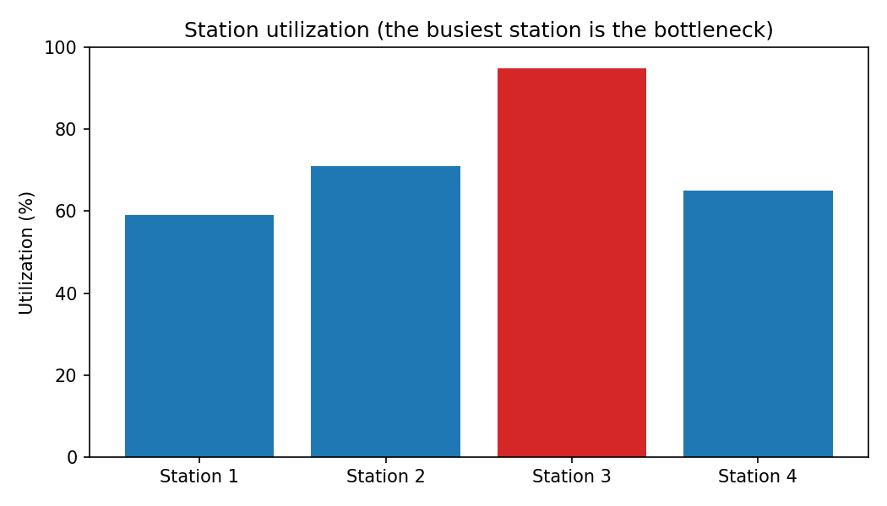
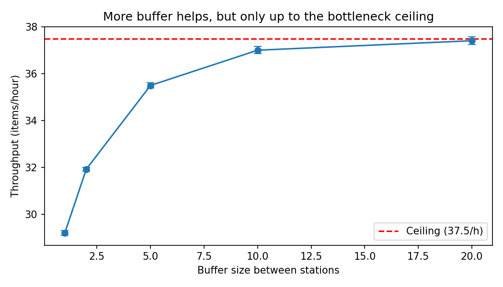
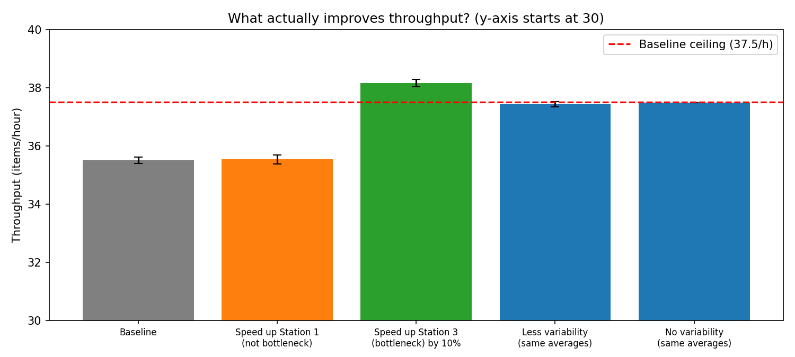

# Production Line Simulation: Finding and Fixing a Bottleneck

A discrete-event simulation (Python + SimPy) of a 4-station serial production line. The model is used to find the bottleneck, estimate throughput with confidence intervals, and compare improvement options **before** spending money on them.

Built as an introduction to **flow and variability**, two core ideas in industrial engineering and operations management. It is a companion to my [SPC and capability study](https://github.com/YOUR-USERNAME/spc-capability-study), which covers variation in quality.

## Problem

A line has 4 stations in series. Each item passes through all of them, with a small buffer (waiting area) in front of each station. Processing times are random.

| Station | Average time per item |
|---|---|
| 1 | 1.0 min |
| 2 | 1.2 min |
| 3 | 1.6 min (slowest) |
| 4 | 1.1 min |

Questions:

1. How many items per hour can the line produce, and what limits it?
2. Which single improvement is worth the money: more buffer space, a faster machine, or lower variability?

## Approach

| Step | What | Why |
|---|---|---|
| 1 | Model the line in SimPy: each station takes an item, works for a random time, then passes it on (waits if the next buffer is full) | Captures blocking and starving, which simple averages miss |
| 2 | Simulate 20 working days (9,600 minutes) per run | Long enough for stable averages |
| 3 | Run **30 replications** per scenario, report mean and **95% confidence interval** | A single run is just one random outcome |
| 4 | Find the bottleneck from station utilization | The busiest station limits the line |
| 5 | Run experiments: buffer size, speeding up a non-bottleneck, speeding up the bottleneck, reducing variability | Compare options on equal terms |
| 6 | Check results against theory: bottleneck ceiling and **Little's Law** (WIP = throughput x cycle time) | Validates the model |

Processing times are exponential in the baseline (high variability). The variability experiment uses a gamma distribution (lower variability) and fixed times (no variability) with the **same averages**.

## Results

All throughput numbers are items per hour, mean over 30 replications with 95% confidence interval.

### 1. The bottleneck is Station 3



Station 3 is busy 95% of the time while the others are at 59% to 71%. Because it needs 1.6 minutes per item, the line can never exceed 60 / 1.6 = **37.5 items/hour**. The simulated baseline is **35.50 +/- 0.11**, below that ceiling because randomness causes blocking and starving.

### 2. Buffers help, with diminishing returns and a real cost



| Buffer size | Throughput | Avg WIP | Avg cycle time |
|---|---|---|---|
| 1 | 29.2 | 6.1 | 12.5 min |
| 2 | 31.9 | 8.9 | 16.8 min |
| 5 (baseline) | 35.5 | 17.6 | 29.7 min |
| 10 | 37.0 | 32.2 | 52.0 min |
| 20 | 37.4 | 61.8 | 98.6 min |

Throughput approaches the 37.5 ceiling but cannot pass it. Going from buffer 5 to 20 adds only about 5% throughput while WIP rises 3.5x and cycle time more than triples. Buffers trade inventory and waiting time for throughput.

### 3. Which improvement actually works?



| Scenario | Throughput | Change vs baseline |
|---|---|---|
| Baseline | 35.50 +/- 0.11 | |
| Speed up Station 1 (not the bottleneck), 1.0 to 0.8 min | 35.54 +/- 0.15 | +0.1% (no real change) |
| Speed up Station 3 (the bottleneck) by 10% | 38.16 +/- 0.12 | **+7.5%** |
| Lower variability, same averages | 37.44 +/- 0.09 | +5.5% |
| No variability, same averages | 37.48 +/- 0.00 | +5.6% |

### 4. Little's Law holds in the model

| Measure | Value |
|---|---|
| Measured average WIP | 17.58 items |
| Throughput x cycle time | 17.55 items |

The two agree closely, which supports the correctness of the model.

## Conclusion

- **Station 3 is the bottleneck** (95% utilization) and caps the line at 37.5 items/hour.
- **Speeding up a non-bottleneck station does nothing** for throughput (+0.1%, within noise). Money spent there is wasted.
- **A 10% faster bottleneck raises throughput by about 7.5%**. The gain is below 10% because other stations start to limit the line once the bottleneck improves.
- **Variability costs capacity.** With identical average times, removing randomness recovers about 5.5% throughput without any new equipment.
- **Larger buffers are not free:** they push throughput toward the ceiling but inflate WIP and cycle time.
- **Recommendation:** invest in Station 3 first. Then reduce variability (standard work, preventive maintenance, consistent material). Keep buffers moderate.

## Limitations

- **No machine breakdowns, setups or scrap.** Real lines have them, and they would lower throughput and raise variability.
- **No warm-up period.** The line starts empty, which slightly understates steady-state throughput. A warm-up cut (discarding the first part of each run) would be a natural improvement.
- **Assumed distributions.** Exponential and gamma times are convenient assumptions. Real processing-time data should be used to fit distributions.
- **Raw material is always available and finished goods are never blocked** at the end of the line.
- Results are specific to these parameters. The ranking of options (bottleneck first) is general, but the exact percentages are not.

## Possible extensions

- Add machine breakdowns and repairs, and compare their effect to the variability results.
- Compare against an analytical queueing model for validation.
- Add a warm-up period and a cost model (machine cost vs. throughput gain).
- Use real cycle-time data to fit processing-time distributions.

## Repository structure

```
bottleneck-line-simulation/
├── README.md
├── LICENSE
├── requirements.txt
├── .gitignore
├── src/
│   └── line_simulation.py          # full script, commented line by line
├── notebooks/
│   └── line_simulation.ipynb       # same analysis, step by step, already executed
├── figures/                        # charts used in this README
└── results/                        # CSV tables of all experiment results
```

## How to run

```bash
git clone https://github.com/arham952/bottleneck-line-simulation.git
cd bottleneck-line-simulation
python -m venv .venv
source .venv/bin/activate        # Windows: .venv\Scripts\activate
pip install -r requirements.txt

python src/line_simulation.py              # runs all experiments, shows charts, saves outputs
python src/line_simulation.py --no-show    # same, without pop-up windows
```

Random seeds are fixed (0 to 29), so results are reproducible. Runtime is about a minute.

## Key terms

- **Bottleneck:** the slowest station, which limits the whole line.
- **Throughput:** finished items per hour.
- **Utilization:** fraction of time a station is busy.
- **Buffer:** waiting space between stations. A full buffer **blocks** the station before it; an empty one **starves** the station after it.
- **WIP:** work in progress, items inside the line.
- **Cycle time:** time an item spends in the line.
- **Little's Law:** WIP = throughput x cycle time.
- **Replication:** one complete simulation run; many are used to estimate mean and confidence interval.

## Tech stack

Python 3, SimPy, NumPy, pandas, Matplotlib, SciPy

## License

MIT. See [LICENSE](LICENSE).
